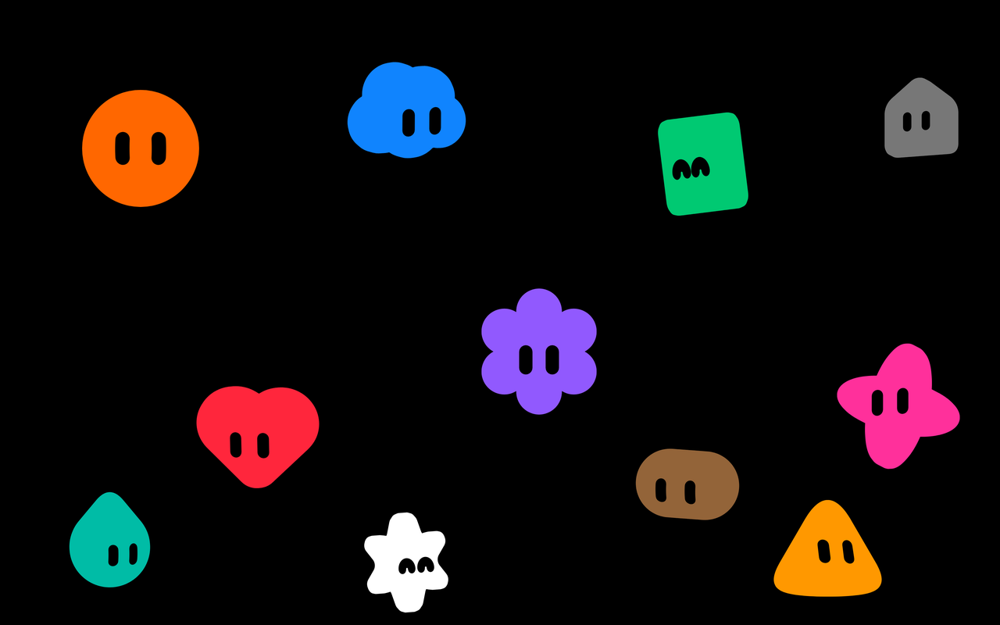

# Grok Bot Screensaver



A Grok Bot face bounces around a black screen. Every time it hits an edge it turns into a different face, with a new shape and a new color. The faces are little 3D bodies in one flat color, like the Grok Bot face marks, with the two slanted capsule eyes cut out. They tip in 3D to look where they're heading, blink now and then, and when one lands exactly in a corner it does a happy spin. It works on Windows and macOS, and each monitor gets its own face.

This is a fan-made screensaver, inspired by the Grok Bot face marks. It isn't an official Grok Bot product.

**Download:** get the zips from this repo's Releases page ([latest release](../../releases/latest)).

| Platform | Download |
| --- | --- |
| Windows 10/11 | `GrokBotScreensaver-Windows.zip` from the latest release |
| macOS 12+ (Apple Silicon and Intel) | `GrokBotScreensaver-macOS.zip` from the latest release |

Demo video: [GrokBotScreensaver-demo.mp4](GrokBotScreensaver-demo.mp4). It was recorded on Linux under Mono from an instrumented copy of the Windows code (frame logging, a fixed random seed and a start aimed at a corner), not from the released screensaver. It holds about 45 frames per second of real animation in a 60 fps video.

## What it does

- **13 shapes**, the same ones as the Grok Bot avatar picker: Blob, Cloud, Square, Sparkle, Clover, Heart, Flower, Teardrop, Tablet, Wedge, House, Star and Hex.
- **11 colors** from the Grok Bot palette: White, Brown, Red, Orange, Yellow, Green, Cyan, Blue, Violet, Magenta and Gray.
- Each face is a 3D body drawn with flat, unlit color: one solid fill, with no shading, highlights, gradients or outline. You see the 3D in the outline and the eyes shifting as the body turns. The eyes are two slanted capsules cut out of the body.
- Each time the face bounces off an edge it switches at once to a new shape and a new color, never repeating the one it just had.
- Between bounces the face tips in 3D to look the way it's heading (up-left, up-right, down-left or down-right): about 21 degrees of turn and 11 of nod, less for the round Blob, the Heart and the Wedge. The bounce knocks it toward its new direction and it settles there in about a quarter of a second, with one small overshoot. It holds that pose until the next wall: no wobble, no sway.
- When the face is about to land exactly in a corner, it turns to look straight at you. When it hits the corner it squints happily and does a full spin.
- The face blinks every few seconds, and sometimes right after a bounce. The lids come down from the top, like the app's own blink: the Blob's eyes close to a thin line, and on the other shapes they close to small dots.
- The face is about one sixth the size of the screen's shorter side, so it looks the same on any resolution.
- Plain black background, no network access, and no settings to configure.
- On Windows the face also plays in the small preview monitor of the Screen Saver Settings dialog.

## Install on Windows

1. Download and unzip `GrokBotScreensaver-Windows.zip`.
2. Double-click `Install.cmd`. You don't need admin rights.
3. That's it. The screensaver starts after 10 minutes idle.

`Install.cmd` copies `Grok Bot Screensaver.scr` to `%LOCALAPPDATA%\GrokBotScreensaver` and sets it as your screensaver for your Windows account only. The Screen Saver Settings dialog shows a live preview in its little monitor. To try it full screen, click **Preview** there, or right-click `Grok Bot Screensaver.scr` and choose **Test**. To change the wait time or turn it off, open **Settings > Personalization > Lock screen > Screen saver**.

Windows SmartScreen may warn you because the file isn't signed. Choose **More info > Run anyway**.

**Uninstall:** pick a different screensaver (or None) in the Screen saver settings, then delete `%LOCALAPPDATA%\GrokBotScreensaver`.

## Install on macOS

1. Download and unzip `GrokBotScreensaver-macOS.zip`.
2. Double-click `Grok Bot Screensaver.saver` and choose whether to install it for just you or for all users.
3. Open **System Settings > Screen Saver** and select **Grok Bot Screensaver**.

The app isn't notarized by Apple. If macOS says it can't be opened, go to **System Settings > Privacy & Security**, scroll down, and click **Open Anyway**. You can also right-click the file and choose **Open**.

**Uninstall:** right-click Grok Bot Screensaver in the Screen Saver settings and choose **Delete**, or remove it from `~/Library/Screen Savers`.

## Exiting the screensaver

Press any key, click, or move the mouse.

## Project layout

```
sprites/face-<shape>.png       Distance-field sprite sheets, one per shape (shared by both platforms)
windows/GrokFaces.cs           Windows screensaver (C# WinForms, .NET Framework 4)
windows/GrokBot.ico            Windows icon
windows/Install.cmd            Per-user installer for Windows
macos/GrokFaces/Motion.swift   macOS faces, blink and motion (plain Swift, same model as the Windows version)
macos/GrokFaces/GrokFacesView.swift   macOS screensaver view (ScreenSaverView subclass: decoding and drawing)
macos/GrokFaces/Info.plist     macOS bundle info
macos/GrokFaces/thumbnail*.png Picture shown in the macOS Screen Saver picker
macos/build.sh                 Builds a universal "Grok Bot Screensaver.saver" on a Mac
art/preview.png                The picture at the top of this page
art/contact-sheet.png          All 13 shapes in 6 colors
.github/workflows/build.yml    Builds both platforms on manual runs and on version tags
CHANGELOG.md                   Release notes
```

## Build it yourself

**Windows.** Use the C# compiler that comes with Windows. No Visual Studio needed:

```
cd sprites
%WINDIR%\Microsoft.NET\Framework64\v4.0.30319\csc.exe /target:winexe "/out:..\Grok Bot Screensaver.scr" /win32icon:..\windows\GrokBot.ico /r:System.Windows.Forms.dll /r:System.Drawing.dll /resource:face-blob.png /resource:face-cloud.png /resource:face-square.png /resource:face-sparkle.png /resource:face-clover.png /resource:face-heart.png /resource:face-flower.png /resource:face-teardrop.png /resource:face-tablet.png /resource:face-wedge.png /resource:face-house.png /resource:face-star.png /resource:face-hex.png ..\windows\GrokFaces.cs
```

The sprite sheets are built into the `.scr` file, so it's the only file you need.

**macOS.** You need the Xcode command line tools (`xcode-select --install`):

```
./macos/build.sh              # builds and installs to ~/Library/Screen Savers
./macos/build.sh --no-install # builds only
```

**Automatic builds.** GitHub Actions builds both platforms when you start the workflow by hand or push a version tag (`v*`), using GitHub's Windows and macOS machines. The finished zips are attached to that run as build artifacts. The workflow doesn't create releases: to publish a release, download the zips from the run and attach them to the release yourself.

## How it works

Both versions follow the same logic. Every frame, the face moves by its velocity for the time since the last frame. When it hits an edge it bounces back and switches to a new random shape and color. On macOS 14 and later a new frame is drawn on every display refresh, up to 120 per second on a ProMotion display. On macOS 12 and 13 it's drawn about 60 times per second. On Windows a 15 ms timer draws the frames, about 64 per second (Windows rounds the timer to its default 15.6 ms clock tick). On both platforms the motion is computed in fixed physics steps of 1/120 s, so the speed is the same at any frame rate.

**Travel.** The face moves in a straight line at a fixed speed, at a random angle between 28 and 62 degrees off the horizontal. Positions are advanced in fixed physics steps of 1/120 s. When a step carries the face past a wall, the overshoot is mirrored back, so the bounce never makes it jump and its speed never changes. The tilt never feeds back into the travel. A bounce counts as a corner hit when both walls are hit within one frame of each other.

**Tilt.** The face tips in 3D, turning (left and right) and nodding (up and down), to look where it's heading. A damped spring pulls the turn and the nod toward that pose: 1.4 Hz with a damping ratio of 0.65. That gives one overshoot of about 6 percent and settles to within 10 percent in about 0.25 s and to within 2 percent in about 0.65 s. On a bounce off a side wall the turn gets a push toward its new target, and off the top or bottom the nod does, in proportion to how fast the face hit the wall. The push starts in the frame of the impact. Before a corner the face looks straight at you. After a corner it plays the celebration (happy eyes, a full turn that overshoots and swings back, and a little tilt) and then settles back into its travel pose.

**Shape and color.** Both change at once on the impact frame. The next shape is picked one bounce ahead, and its sheet is decoded in the background while the face travels, so the switch never waits for it. Every bounce switches the shape. If two bounces come too quickly for the next sheet to be ready, the face switches back to the shape it had before, which is still decoded, so it never waits.

**Sprites.** The faces are pre-rendered. Each shape has one sprite sheet of 450 frames of 256x256 pixels, in a grid of 12 columns:

- Frames 0 to 374 are 3D renders on a turn x nod grid, 2 degrees apart: turn -24 to 24 degrees, nod -14 to 14 degrees. Frame number = nod step x 25 + turn step.
- Frames 375 to 449 are the corner celebration, at 30 frames per second.

Each frame shows the four renders around the current turn and nod, blended by how far the angle sits between them. At 2-degree steps the outline and the eyes move about 3 sprite pixels from one render to the next, so the blend looks like a real in-between angle. Only the shape on screen and the next one are kept decoded, about 30 MB each.

**Blink.** The blink is drawn from the open eyes, following the app's own face engine. The lid comes down along the eye and squashes it toward a point 60 percent of the way down, to 3 percent of its length at most. On the Blob the whole eye is squashed, so a closed eye is a thin line, 0.124 x 0.008 of the face width as in the app. On the other shapes the engine squashes only the straight middle of the eye and keeps its round ends, so a closed eye is a dot as wide as the open eye. A blink takes 0.26 s: 0.08 s to close, 0.07 s shut and 0.11 s to open. After it the eyes stay open for at least 0.3 s, so two blinks never run into each other. For this, each sheet carries the eye geometry of every open-eye frame (centre, lid direction, direction of the closed line, and size) in a small private PNG chunk named `eyEs`.

**Distance fields.** To keep the download small, the sheets don't store colors. Each one is a grayscale signed distance field. A pixel value of 128 is the outline. Higher values are inside the body, lower values are outside it and in the eye holes, and each sprite pixel is 8 steps. The screensaver turns the field into a smooth edge and fills it with the chosen palette color.

The sprites were rendered from the Grok Bot face mark shapes posed in 3D, with every surface in the same flat color and no lighting. The look is inspired by the Grok Bot face marks. This is a fan-made screensaver.
